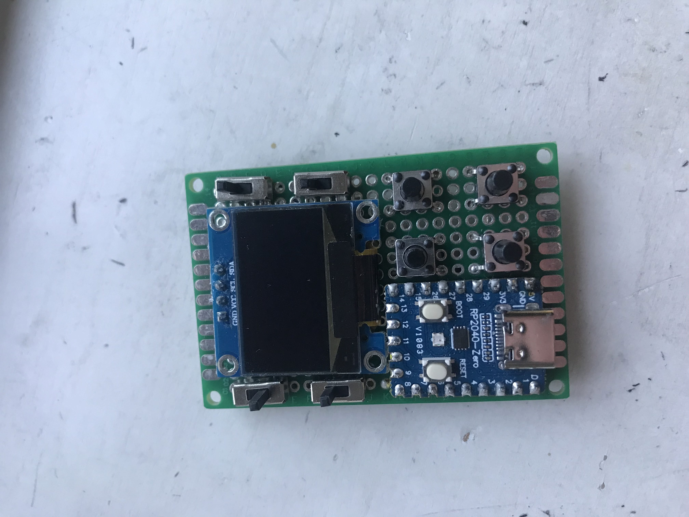
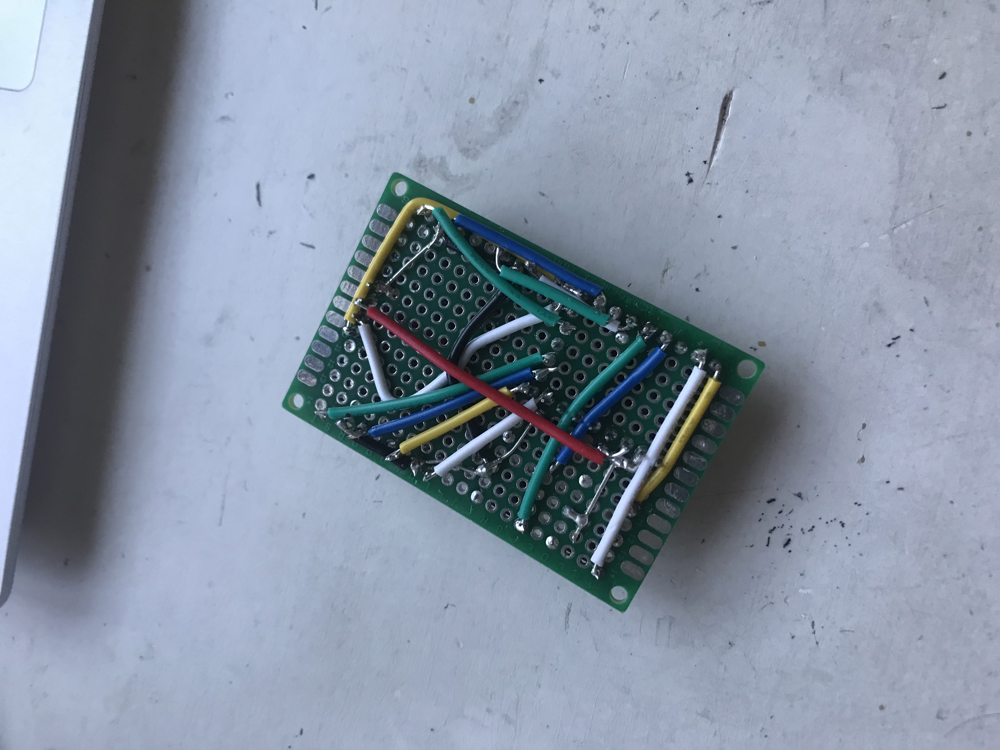

# Hacker_Calc
A basic calculator made from a perfboard, Waveshare RP2040 Zero, and buttons!

The OLED is for displaying what you wrote and the answer (duh), the buttons execute actions, and the switches set the operation.

# ASSEMBLY

Check out the BOM for the individual components w/ links, but here's a recap: in total it's gonna cost you $6.64, you're gonna need a WaveShare RP2040 Zero, four 5x5mm pushbuttons, four slide switches, a 6x4cm perfboard, and a 128x64 OLED display. Take a lookie at the image above if you're feeling lost during assembly! PS: make sure your OLED uses a SSD1306 driver!

- Solder the display onto the perfboard, GND on A6 and SDA on A9.
- Solder the switches onto the perfboard beside the OLED, however you like!
- Solder the RP2040 onto the perfboard, 5V on T7 and GND on S7.
- Solder the remaining buttons however you like!

Here is the wiring diagram:

| Pin # | Part      | Part Pin | Purpose         |
| ----- | --------- | -------- | --------------- |
| 0     | Button BL |          | Execution       |
| 1     | Button BR |          | Clear           |
| 2     |           |          |                 |
| 3     | Button TL |          | Number Input    |
| 4     | Button TR |          | Operation Input |
| 5     | SW BL     | B        | Division        |
| 6     | SW BL     | A        | Subtraction     |
| 7     | SW TL     | B        | Multiplication  |
| 8     | OLED      | SDA      |                 |
| 9     | OLED      | SCL      |                 |
| 10    | SW TL     | A        | Addition        |
| 11    |           |          |                 |
| 12    | SW TR     | A        | Power of X      |
| 13    | SW TR     | B        | Root of X       |
| 14    | SW BR     | A        | Prev. Ans       |
| 15    | SW BR     | B        | Move On         |
| 26    |           |          |                 |
| 27    |           |          |                 |
| 28    |           |          |                 |
| 29    |           |          |                 |

An image for reference! 

Here's a photo of the CAD! Print out the case from the .step file in the STEP Files folder if you like, I decided not to print the case cuz I'm tuff like that. 

Download main.cpp and the SSD1306 drivers from the code folder, make a project with VS code's Pico extension, move the files into your project's folder, compile, and upload to the RP2040! Enjoy using your HackerCalc!

# USE

The top left button is used to input numbers. Input them in Morse code. The top right button inputs operations, based on the most recently moved switch. The bottom left button computes, and the bottom right button clears. You can customize the operations the switches trigger!

# AI USE

AI was used to debug. 
