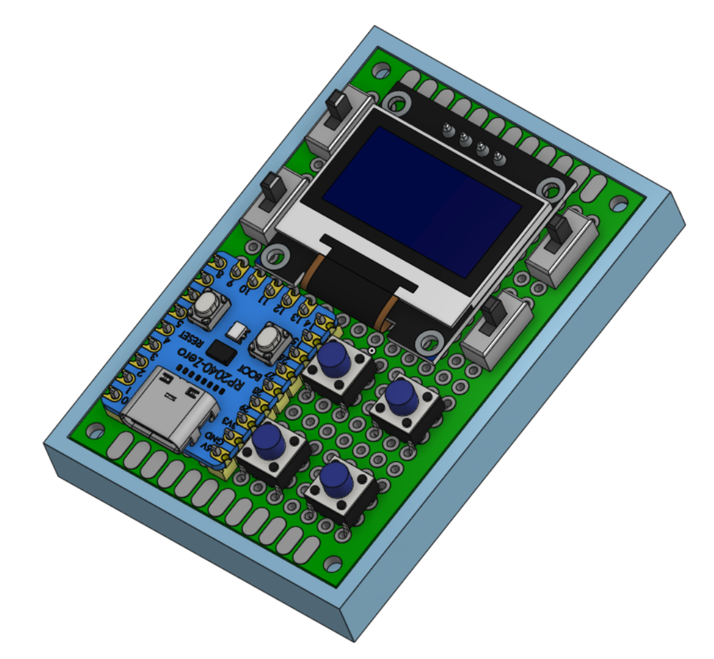

# Hacker_Calc
A basic calculator made from a perfboard, Waveshare RP2040 Zero, and buttons!

The OLED is for displaying what you wrote and the answer (duh), the buttons execute actions, and the switches set the operation.

Here is the wiring diagram:

| Pin # | Part      | Part Pin | Purpose         |
| ----- | --------- | -------- | --------------- |
| 0     | Button BL |          | Execution       |
| 1     | Button BR |          | Clear           |
| 2     |           |          |                 |
| 3     | Button TR |          | Operation Input |
| 4     | Button TL |          | Number Input    |
| 5     | SW BL     | B        | Division        |
| 6     | SW BL     | A        | Subtraction     |
| 7     | SW TL     | B        | Multiplication  |
| 8     | SW TL     | A        | Addition        |
| 9     | OLED      | SCL      |                 |
| 10    | OLED      | SDA      |                 |
| 11    | SW TR     | A        | Power of X      |
| 12    | SW TR     | B        | Root of X       |
| 13    | SW BR     | A        | Prev. Ans       |
| 14    | SW BR     | B        | Move On         |
| 15    |           |          |                 |
| 26    |           |          |                 |
| 27    |           |          |                 |
| 28    |           |          |                 |
| 29    |           |          |                 |

Here's a photo of the CAD! I'll code it and actually make it after I ship this cuz I wanna contribute to the 500h by Nov 18 :P

